# 프로젝트 구현 및 검증 안내

## 프로젝트 개요

이 프로그램은 의료 IT, 인공지능, 디지털 헬스케어에 관한 객관식 문제를 풀고, 직접 문제를 추가하거나 목록을 관리하는 Python 콘솔 게임입니다. 콘솔 프로그램은 웹 화면 대신 명령 프롬프트나 PowerShell에 글자를 입력해 사용하는 프로그램을 말합니다.

기본 문제는 세 주제에서 5개씩 총 15개입니다. 사용자는 현재 저장된 문제 수에 맞는 5·10·15문제 모드를 선택해 게임을 합니다. 정답과 힌트 사용을 바탕으로 점수를 계산하고, 문제·최고 점수·게임 기록을 JSON 파일에 보관합니다. JSON은 글자와 숫자처럼 사람이 읽을 수 있는 자료를 정해진 구조로 저장하는 형식입니다.

### 주제를 고른 이유

의료 IT와 디지털 헬스케어는 병원의 정보 시스템과 일상 건강 관리에 연결되고, 인공지능은 의료 데이터 분석 및 새로운 서비스와 관련됩니다. 세 주제를 다루면 Python의 자료형, 목록, 함수, 클래스, 파일 저장을 실제 문제와 연결해 연습할 수 있습니다. 이 설명은 프로젝트 README의 주제 선정 이유를 풀어 쓴 것이며, 별도의 외부 자료 목록은 저장소에서 확인되지 않았습니다.

## 실행 환경과 시작 방법

현재 검증 환경은 Windows PowerShell과 Python 3.12.10입니다. 코드는 Python 3.10부터 지원되는 타입 표기법을 사용하고, 외부 패키지 없이 표준 라이브러리만 사용합니다.

프로젝트 폴더에서 다음 명령을 실행합니다.

```powershell
python --version
python main.py
```

화면에 `1. 퀴즈 풀기`부터 `6. 퀴즈 삭제`까지 표시됩니다. 종료를 확인하는 가장 짧은 실행 예시는 메뉴에 `5`를 입력하는 것입니다. 예상 결과는 `프로그램을 종료합니다.`입니다. 이 확인은 데이터를 저장하지 않습니다.

`main.py`를 직접 실행하면 프로젝트 폴더의 `state.json`을 사용합니다. 문제·점수 데이터를 바꾸는 실습은 아래의 임시 경로 실행 예시처럼 별도 저장 파일을 지정하면 실제 개인 기록을 보호할 수 있습니다.

## 핵심 용어와 동작 원리

### 문항 객체와 클래스

클래스는 같은 모양의 자료를 만드는 설계도이고, 객체는 그 설계도로 만든 실제 자료 한 개입니다. `quiz.py`의 `Quiz` 클래스는 문제, 선택지 네 개, 정답 번호, 힌트를 한 묶음으로 관리합니다. 예를 들어 “PACS의 주요 역할은?”이라는 문제 객체에는 보기 네 개와 정답 번호 3이 들어 있습니다. `Quiz.check_answer(3)`은 `True`를, 다른 번호에는 `False`를 돌려줍니다.

`quiz_data.py`의 `get_default_quizzes()`는 매번 새 `Quiz` 객체 15개를 반환합니다. 기본 내용은 코드 안의 `_QUESTION_DATA`에 주제별로 작성되어 있습니다. 저장소에서 자료를 가져온 외부 주소나 별도의 출처 기록은 확인되지 않습니다.

### 무작위 출제와 점수

`quiz_game.py`의 `QuizGame`은 현재 문항 목록에서 문제를 골라 진행합니다. `random.sample`은 같은 목록에서 지정한 개수만큼 중복 없이 뽑는 Python 표준 함수입니다. 예를 들어 15개 중 5개를 뽑으면 한 게임 안에서 같은 문항이 두 번 나오지 않습니다.

점수는 먼저 `정답 수 ÷ 전체 문제 수 × 100`으로 환산하고, 힌트 요청 한 번마다 10점을 뺍니다. 최저 점수는 0점입니다. 예를 들어 5개 중 4개를 맞히고 힌트를 한 번 요청하면 80점에서 10점을 빼 70점입니다. 구현은 `round()`로 환산값을 정수로 만든 뒤 감점을 적용합니다.

문제 수 모드는 보유 문항 수를 넘을 수 없습니다. 7개를 보유하면 5개 모드만, 12개면 5개와 10개 모드가 가능하며, 5개 미만이면 게임이 시작되지 않습니다. 문제를 뽑기 직전에도 개수를 다시 확인해 문항 수가 모자란 상태에서 `random.sample` 오류가 생기지 않게 방어합니다.

### 저장, 복원, 되돌리기

`state_store.py`의 `StateStore`는 `state.json`을 읽고 쓰는 역할을 맡습니다. 파일에는 버전, 퀴즈 목록, 최고 점수, 전체 게임 히스토리가 들어갑니다. 히스토리는 완료된 각 게임의 날짜·시간, 문제 수, 정답 수, 점수를 말합니다.

저장할 때는 먼저 임시 파일에 UTF-8 JSON을 쓴 다음 원래 파일과 교체합니다. 최고 점수와 히스토리는 저장 성공 뒤에만 확정하며, 저장이 실패하면 이전 메모리 상태로 되돌립니다. 퀴즈 추가와 삭제도 저장 실패 시 퀴즈 목록 변경을 취소합니다. 파일이 없으면 기본 문제 15개와 빈 기록으로 시작하고, JSON이 손상되면 오류를 알린 뒤 메모리에서 기본 자료를 사용합니다. 이때 `StateStore`는 로드 실패 상태를 기록하고 원본 보존을 위해 저장을 거부합니다. 파일을 외부에서 복구한 뒤 프로그램을 다시 실행해 `load()`가 성공해야 저장이 재개됩니다. 저장된 빈 퀴즈 목록은 정상 상태일 수 있으므로 기본 15개로 자동 채우지 않습니다.

### 클래스로 책임을 나눈 이유

`Quiz`는 문항 한 개의 자료와 유효성 규칙을 함께 가집니다. 생성 시 문제·보기·정답 형식을 검사하고, 같은 방식으로 답을 판정하거나 JSON 자료로 바꾸므로 메뉴 코드마다 같은 검사를 반복하지 않아도 됩니다.

`QuizGame`은 여러 문항으로 한 판을 진행합니다. 문제 수 선택, 무작위 추출, 답 입력, 힌트, 점수 계산을 한곳에서 처리하므로 게임 흐름을 메뉴 처리 및 파일 입출력과 따로 확인할 수 있습니다.

`StateStore`는 퀴즈·점수의 저장 위치와 JSON 형식, 파일 오류 대응을 맡습니다. 게임 코드는 저장 경로나 JSON 세부 형식을 직접 다루지 않아도 됩니다. 예를 들어 `main.py`는 게임 완료 결과를 `record_game()`에 넘기고 저장 결과의 표시만 이어받습니다. 이렇게 나누면 문항 규칙, 게임 규칙, 저장 규칙을 각 책임 안에서 고칠 수 있습니다. 단, `Quiz.display()`가 콘솔에 직접 출력하는 부분처럼 현재 코드가 완전히 계층 분리된 것은 아닙니다.

## 종료 처리와 저장 시점

| 상황 | 현재 동작 | 저장 영향 |
|---|---|---|
| 메뉴 5번 정상 종료 | 종료 메시지를 출력하고 메뉴 반복을 마칩니다. | 종료만으로 별도 저장하지 않습니다. 퀴즈 변경과 게임 기록은 각 동작을 완료할 때 저장합니다. |
| 메뉴·퀴즈 입력 중 EOF | `main.run()`이 `EOFError`를 받아 안내 후 종료합니다. | 입력이 완성되지 않은 추가·삭제 작업은 저장하지 않습니다. 이미 저장된 파일은 그대로 둡니다. |
| Ctrl+C | `KeyboardInterrupt`를 받아 안내 후 종료합니다. 기본 Python 동작이 Ctrl+C를 이 예외로 전달하므로 별도 `signal` 등록은 필요하지 않습니다. | 진행 중 게임은 결과 콜백에 도달하지 않아 히스토리에 기록하지 않습니다. |
| 완료 게임 | 모든 문제의 답을 받은 뒤 결과 콜백이 `StateStore.record_game()`을 부릅니다. | 히스토리와 최고 점수 갱신을 저장합니다. 저장 실패 시 메모리 변경을 되돌립니다. |
| 퀴즈 추가 | 문제·보기·정답·힌트 입력을 완료한 뒤 목록을 저장합니다. | 저장 성공 시에만 게임 목록에 반영합니다. 입력 중단이면 미완성 문항은 저장하지 않습니다. |
| 퀴즈 삭제 | 대상 번호와 삭제 승인 입력을 받은 뒤 새 목록을 저장합니다. | 저장 성공 후에만 삭제를 확정합니다. 취소나 일반 저장 실패는 목록을 유지합니다. |
| 손상·미지원 저장 파일 | 읽기 오류를 알리고 기본 자료로 실행하지만 저장은 차단합니다. 안내에 따라 파일을 복구하고 프로그램을 재실행해야 합니다. | 원본 바이트를 보존합니다. 파일 복구 후 다시 성공적으로 불러오기 전에는 변경 저장이 되지 않습니다. |

임시 파일 교체 전에 중단되면 새 작업은 아직 저장되지 않은 상태이고, 교체 전 원본 파일은 남습니다. 교체가 끝난 뒤라면 완전한 새 JSON 파일이 남습니다. 중단 시 임시 파일이 남지 않는다고 보장하지 않으며, 저장 중 Ctrl+C를 각각의 운영체제 파일 단계에서 주입하는 테스트도 없습니다. 그러므로 이 경로를 별도 중단 테스트로 검증 완료했다고 표현하지 않습니다. `signal` 모듈로 Ctrl+C를 다시 등록해도 `EOFError` 처리는 달라지지 않고, 현재 요구에는 별도 신호 핸들러가 필요하지 않습니다.

### 읽지 못한 저장 파일을 복구하는 절차

로드 오류가 표시되면 프로그램은 기본 문항으로 실행할 수 있지만 저장은 차단됩니다. 이는 손상되었거나 새 버전인 파일을 빈 기본 상태로 덮지 않기 위한 동작입니다. 첫 실행처럼 `state.json`이 아예 없는 경우는 로드 실패가 아니므로 기본 15문항을 사용하고 저장도 할 수 있습니다.

저장 차단을 해제하려면 다음 순서를 따릅니다.

1. 프로그램을 종료하고 원본 `state.json`을 별도 위치에 복사해 보관합니다. 프로그램은 오류 원본을 삭제하거나 자동으로 고치지 않습니다.
2. 보관한 원본을 기준으로 JSON 문법과 필드를 확인합니다. 저장 스키마는 버전 1이며 저장되는 필드는 `version`, `quizzes`, `high_score`, `history`입니다. 로더는 `quizzes`가 목록인지 검사하고, 빠진 `version`은 1로, 빠진 `high_score`는 `None`으로, 빠진 `history`는 빈 목록으로 해석합니다. 퀴즈와 점수 기록의 기존 값을 보존하면서 수동으로 형식을 복구하거나, 기존 버전 파일에서 현재 버전으로 값을 옮깁니다.
3. 복구된 파일을 프로젝트의 `state.json` 위치에 둔 뒤 프로그램을 다시 실행합니다. 읽기 오류가 더 이상 나오지 않고 데이터가 예상대로 표시되는 것을 확인한 뒤에만 저장 작업을 진행합니다.
4. 계속 오류가 나면 저장은 계속 차단됩니다. 이 프로젝트에는 파일을 지우고 기본값으로 초기화하는 자동 복구 메뉴가 없습니다. 원본을 삭제해 오류를 없애는 절차는 안내하지 않습니다.

이 절차는 명시적인 수동 복구 방법이며, 현재 애플리케이션이 구버전 JSON을 자동 마이그레이션한다는 뜻은 아닙니다.

## 메뉴별 사용법과 결과

아래에서 입력 예시는 PowerShell에서 실행했을 때 프로그램이 기다리는 차례대로 입력할 값입니다. 무작위 문제 내용과 정답 수는 게임 실행마다 달라질 수 있으므로 달라지는 값은 범위나 형태로 설명했습니다.

### 1. 퀴즈 풀기

**목적:** 의료 IT·인공지능·디지털 헬스케어 문제를 풀고 최종 점수를 확인합니다.

**동작:** 가능한 문제 수를 보여주고, 모드를 선택하면 중복 없이 출제합니다. 답은 1~4로 입력하고, `h` 또는 `hint`를 입력하면 힌트를 보고 같은 문제에 다시 답할 수 있습니다. 힌트를 여러 번 요청하면 요청마다 10점씩 감점됩니다. 모든 문제를 풀면 정답·오답 개수와 100점 만점 점수를 출력하고 기록을 저장합니다.

**실행:** 메뉴에서 `1`을 입력하고, 가능한 모드 가운데 하나를 고릅니다. 기본 목록이라면 `5`를 입력해 5문제 게임을 선택할 수 있습니다. 그 뒤 매 문제에 표시되는 선택지를 읽고 `1`, `2`, `3`, `4` 중 하나를 입력합니다.

**결과:** 각 문제 뒤에 정답 또는 오답이 표시되고, 마지막에 `퀴즈 결과`, 정답 수, 오답 수, 최종 점수가 표시됩니다. 기록이 정상 저장되면 이후 메뉴 4번과 재실행 후에도 확인할 수 있습니다.

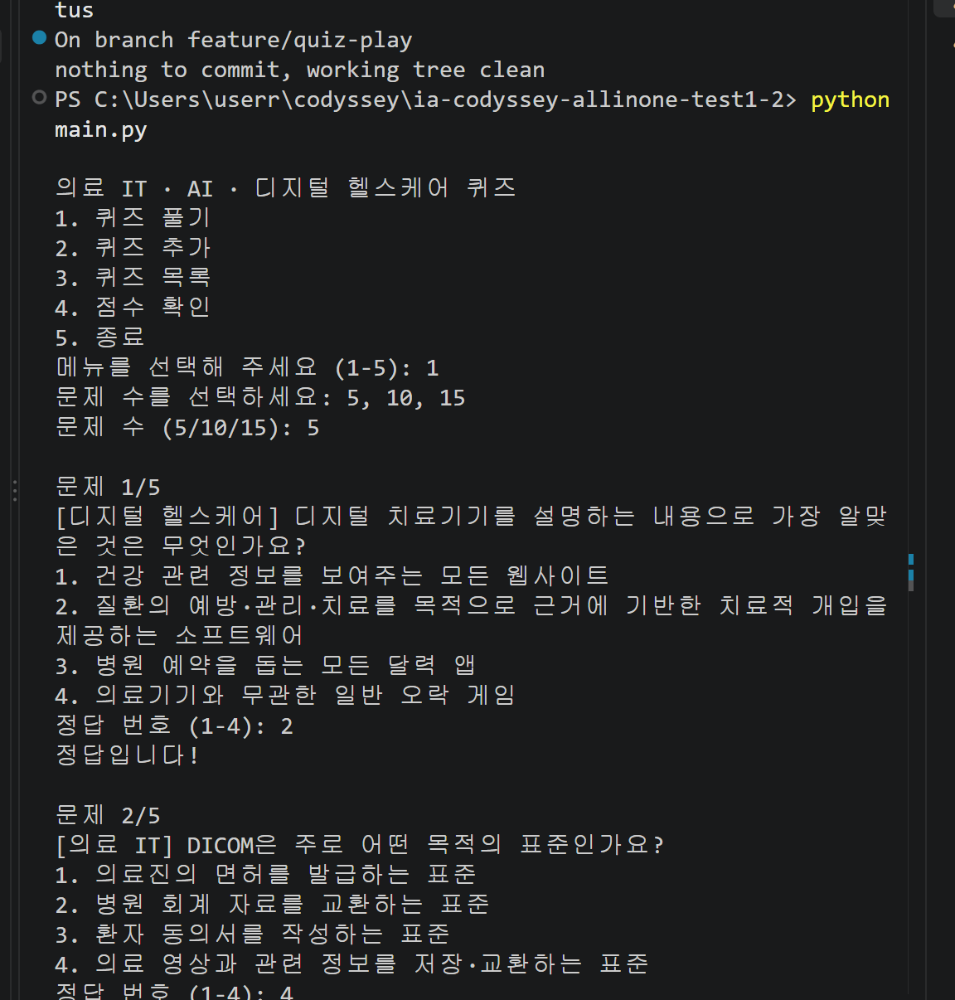

위 화면은 문제와 선택지, 답 입력 방식 및 진행 중인 게임을 보여줍니다.

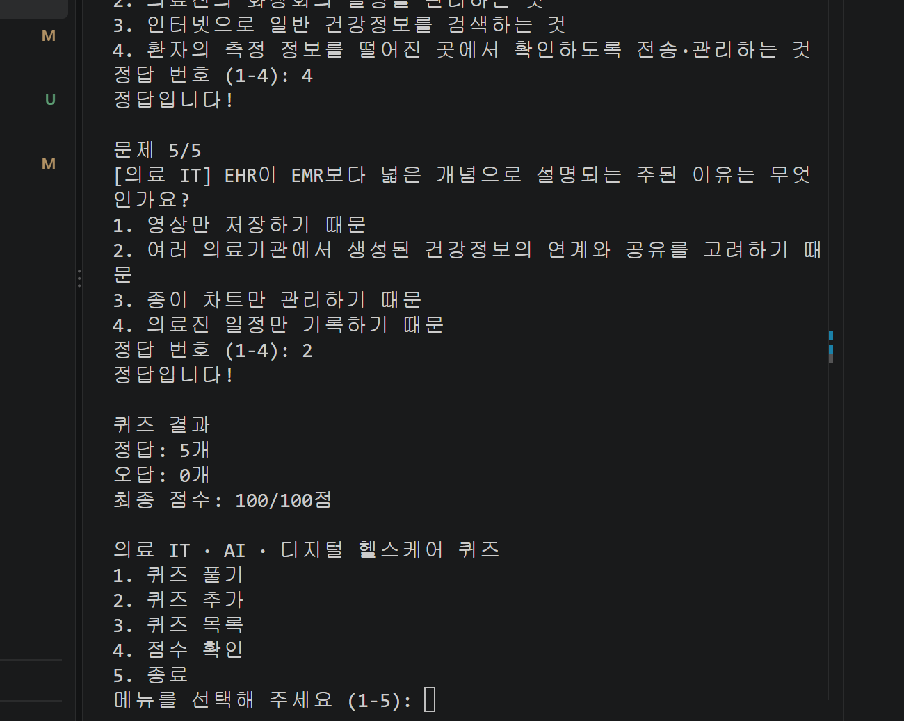

결과 화면에는 정답·오답 수와 최종 점수가 나타납니다.

### 2. 퀴즈 추가

**목적:** 기본 문제 외에 사용자가 원하는 문제를 현재 게임 목록에 추가합니다.

**동작:** 문제, 보기 네 개, 정답 번호 1~4, 힌트를 차례로 입력합니다. 문제와 보기가 공백만 있으면 다시 입력해야 합니다. 앞뒤 공백은 제거합니다. 힌트는 문자열로 입력하며 비워 둘 수도 있습니다. 저장이 성공해야 추가가 확정됩니다.

**실행 예시 입력 순서:** 메뉴 `2`, 문제 `임시 실습 문제`, 보기 `보기 가`, `보기 나`, `보기 다`, `보기 라`, 정답 `2`, 힌트 `두 번째 보기를 생각해 보세요.`를 입력합니다.

**결과:** `퀴즈가 추가되었습니다!`가 표시됩니다. 메뉴 3번에서 새 문항을 확인하고, 메뉴 1번의 출제 대상에도 포함됩니다. 재시작 뒤 유지 여부는 `state.json`에 저장된 데이터로 확인할 수 있습니다.

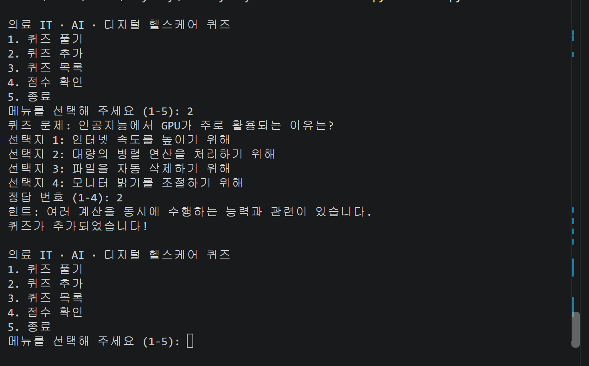

화면에서 문제와 보기를 입력하고 정답과 힌트를 등록하는 순서를 볼 수 있습니다.

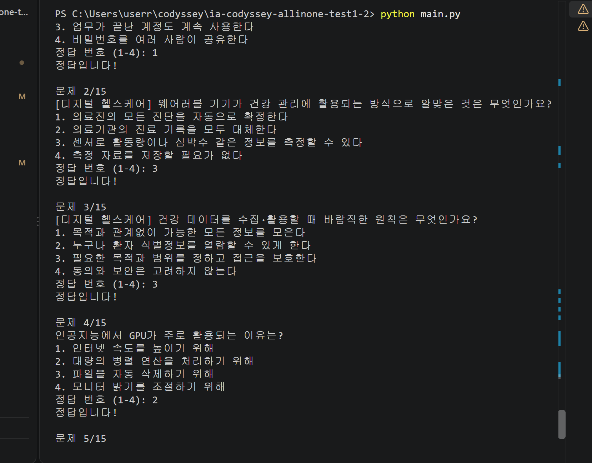

추가한 문항이 게임 문제 풀에 들어간 것을 보여주는 증빙입니다.

### 3. 퀴즈 목록

**목적:** 현재 등록된 전체 문항을 확인하되 정답과 힌트는 숨깁니다.

**동작:** `Quiz.display()`를 사용해 문제와 보기 네 개를 순서대로 표시합니다. 정답 번호와 힌트는 출력하지 않습니다. 목록이 비어 있으면 안내 문구를 표시하고 메뉴로 돌아갑니다.

**실행:** 메뉴에 `3`을 입력합니다. 저장된 기본 문항과 사용자 문항을 차례대로 확인한 뒤 다음 메뉴 입력을 계속합니다.

**결과:** 각 문항의 순번, 문제, 선택지 네 개가 출력됩니다. 확인 후 다시 메뉴가 표시됩니다.

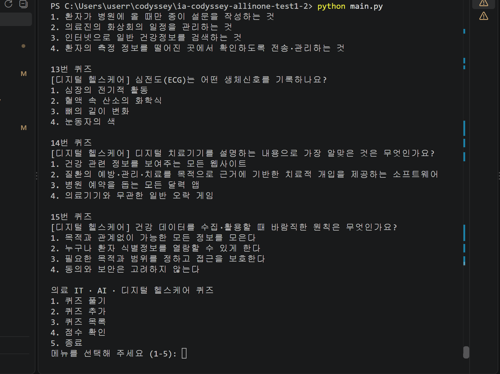

기본 문항을 문제와 보기만으로 나열한 화면입니다.

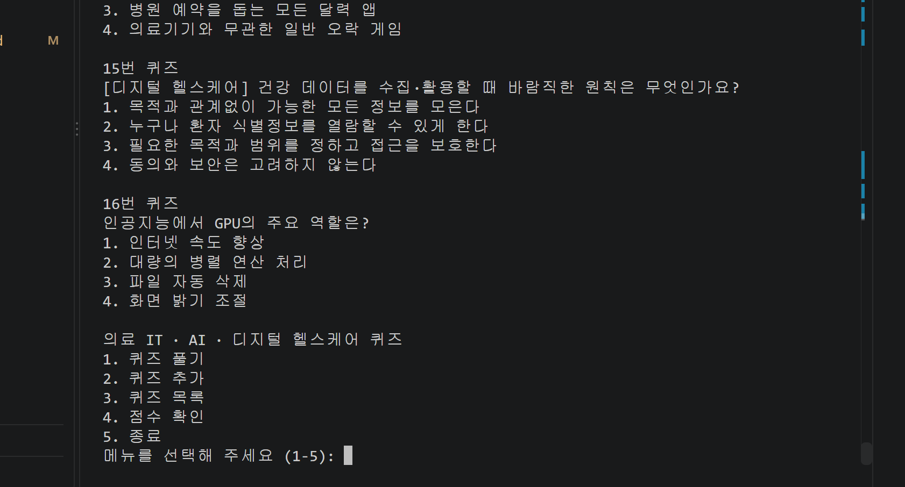

사용자 추가 문항이 기존 문항과 함께 표시되는 것을 확인할 수 있습니다.

### 4. 점수 확인

**목적:** 최고 점수와 지금까지 완료한 게임 기록을 확인합니다.

**동작:** 가장 높은 점수만 최고 점수로 보관합니다. 그보다 낮은 결과도 히스토리에는 쌓이며, 동점이면 처음 최고 점수의 시각을 유지합니다. 게임을 끝낼 때마다 날짜·시간, 문제 수, 정답 수, 점수를 기록합니다.

**실행:** 메뉴에 `4`를 입력합니다. 아직 게임을 완료하지 않았다면 안내가 나오고, 완료 기록이 있으면 최고 점수와 기록 목록을 확인합니다.

**결과:** 최고 점수와 날짜·정답 수, 전체 게임 기록이 출력됩니다. 저장 오류가 발생한 경우 오류를 알리고 최고 점수와 히스토리를 이전 메모리 상태로 복구합니다.

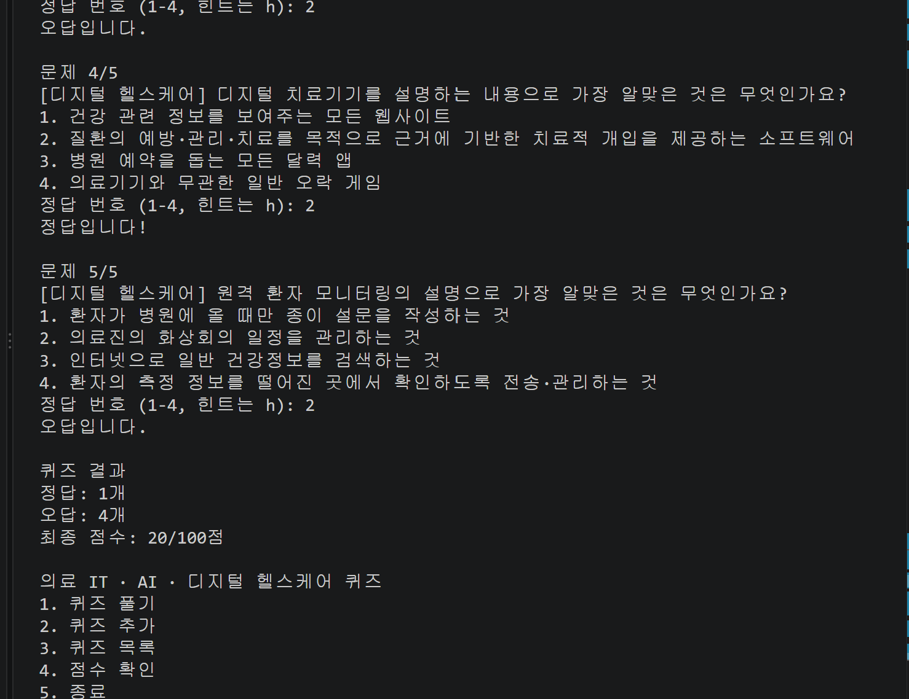

첫 번째 완료 게임에서 점수와 기록이 생성되는 화면입니다.

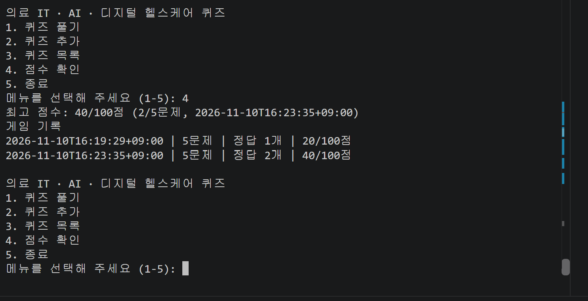

서로 다른 게임 결과에서 최고 점수를 비교하는 화면입니다.

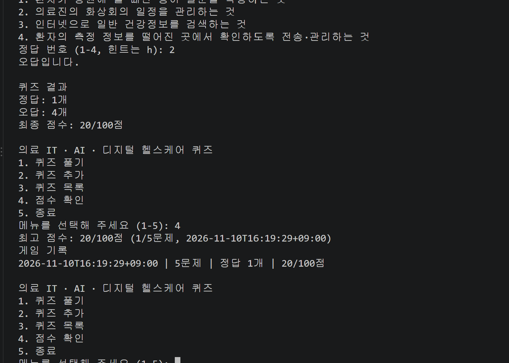

날짜와 점수를 포함한 여러 게임 기록을 확인할 수 있습니다.

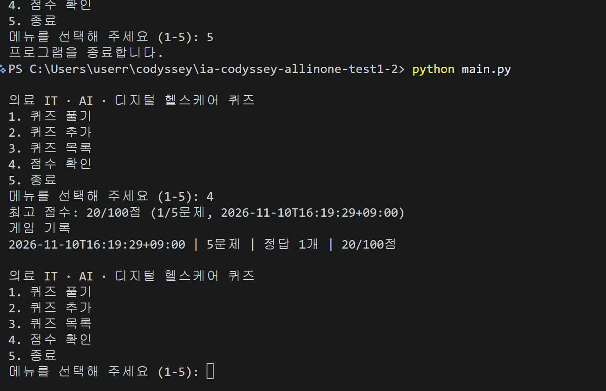

프로그램을 다시 실행한 뒤 이전 기록이 복원된 화면입니다.

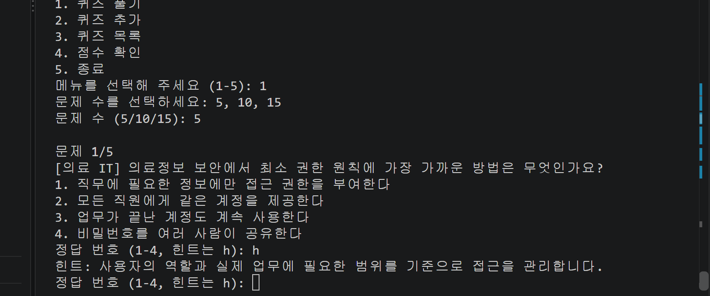

문제 풀이 중 힌트 요청과 힌트 내용 표시를 확인할 수 있습니다.

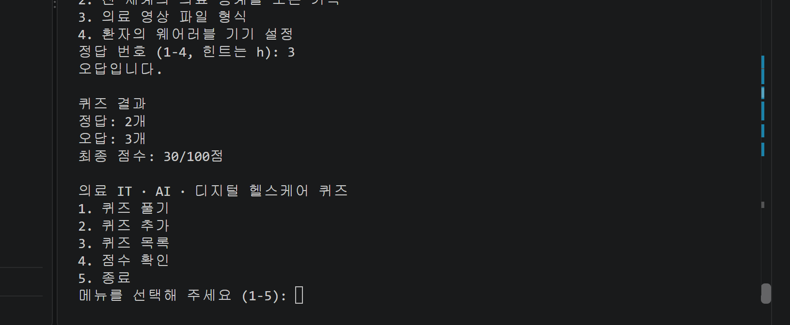

힌트를 사용한 결과에서 감점이 반영되는 화면입니다.

### 5. 종료

**목적:** 메뉴 반복을 끝내고 프로그램을 종료합니다.

**실행 및 결과:** 메뉴에 `5`를 입력하면 `프로그램을 종료합니다.`가 표시됩니다. 이 동작은 추가 저장을 하지 않습니다.

### 6. 퀴즈 삭제

**목적:** 등록된 문항을 삭제하고 다음 실행에도 삭제 상태를 유지합니다.

**동작:** 번호와 문제 제목을 먼저 보여주고, 선택한 문제 내용과 보기를 다시 표시해 확인을 받습니다. `y` 또는 `yes`만 삭제를 승인하고, `n` 또는 `no`는 취소합니다. 잘못된 번호, 문자, 빈 입력은 재입력할 수 있습니다. 기본 문제와 사용자 문제가 모두 삭제 대상입니다. 마지막 문제를 지우면 빈 목록이 저장되며 기본 문제를 되살리지 않습니다.

**실행 예시:** 메뉴 `6`, 삭제할 번호 `1`, 문제 내용을 확인한 뒤 승인 입력 `y`를 차례대로 입력합니다. 취소를 확인하려면 같은 흐름에서 마지막에 `n`을 입력합니다.

**결과:** 승인과 저장이 성공하면 `퀴즈가 삭제되었습니다.`가 표시됩니다. 취소는 메모리 목록과 저장 파일을 그대로 둡니다. 저장에 실패해도 퀴즈 목록을 메모리에서 제거하지 않습니다. 점수와 히스토리는 삭제 전과 같이 보존됩니다.

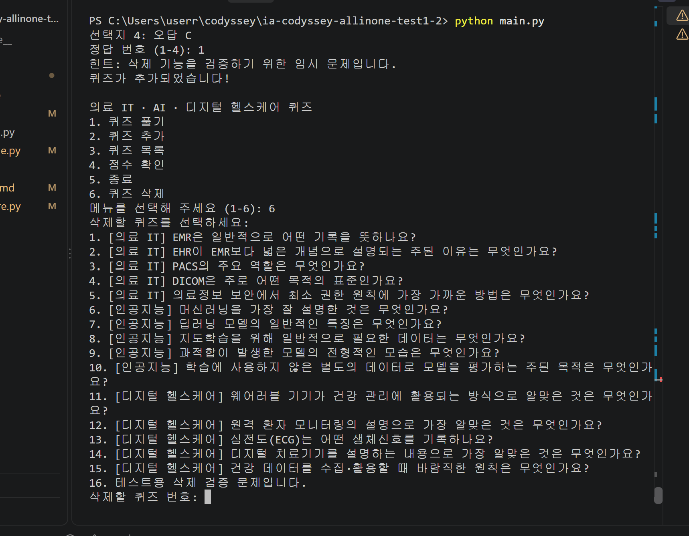

번호와 문제 제목으로 삭제 대상을 고르는 화면입니다.

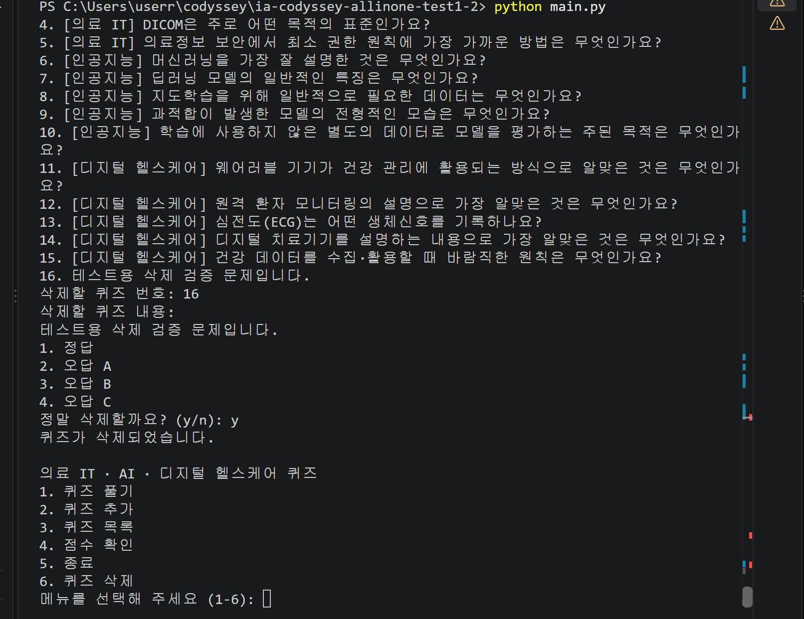

삭제 확인 뒤 성공 안내가 나오는 것을 볼 수 있습니다.

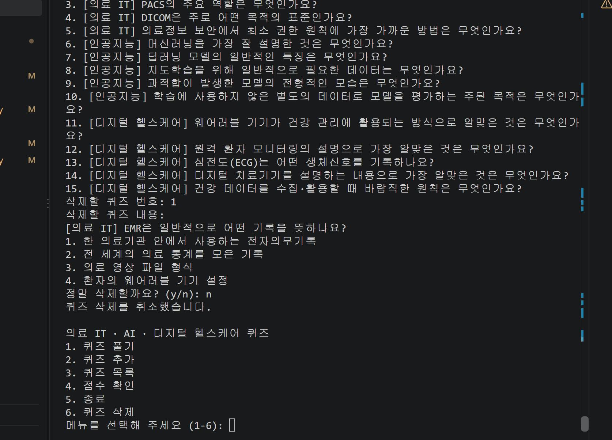

취소 선택 뒤 삭제하지 않는 흐름을 보여줍니다.

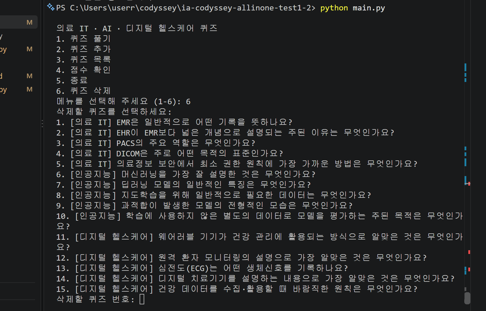

재실행 후 삭제한 문항이 목록에 돌아오지 않는 것을 확인할 수 있습니다.

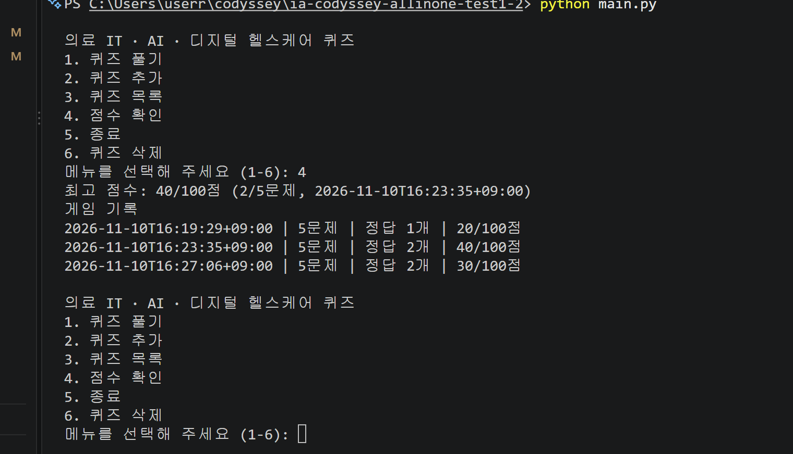

문항 삭제 뒤에도 기존 게임 기록이 보존되는 화면입니다.

## 검증 과정과 결과

### 정상·오류·경계값

저장소의 `unittest` 테스트는 사용자 데이터와 분리된 임시 디렉터리에서 파일 저장·복원을 확인합니다. `unittest`는 Python에 포함된 자동 검사 도구입니다. 다음 표의 결과는 현재 소스와 테스트 코드에서 확인되는 범위입니다.

| 점검 상황 | 확인 결과 | 근거와 의미 |
|---|---|---|
| 정상 기본 데이터 | 통과 | 기본 문항 15개, 주제별 5개, 필드 및 문제 중복 여부를 테스트합니다. |
| 정답과 문항 표시 | 통과 | 정답 확인, 보기 표시, 목록에서 정답·힌트 숨김을 확인합니다. |
| 입력 오류 | 통과 | 문자, 빈 값, 범위 밖 숫자를 다시 입력받고 올바른 입력을 수락합니다. |
| 문항 수 0개·4개 | 통과 | 최소 5개가 필요하다고 안내하고 무작위 추출이나 기록을 하지 않습니다. |
| 문항 수 5·7·9·10·14·15개 | 통과 | 현재 풀에 맞는 모드만 허용하고 불가능한 모드 선택은 재입력시킵니다. |
| 출제 직전 문항 수 감소 | 통과 | 추출 직전 재확인하여 요청 수가 풀보다 많으면 안전하게 중단합니다. |
| 힌트 1회 사용 | 통과 | 5문제 전부 정답이어도 힌트를 1회 쓰면 90점이 됩니다. |
| JSON 파일 없음 | 통과 | 기본 15문항과 빈 기록으로 시작하며 파일을 임의 생성하지 않습니다. |
| JSON 손상 또는 구조 오류 | 통과 | 안내 메시지와 함께 기본 자료로 실행하되, 원본 덮어쓰기는 차단합니다. |
| 점수 갱신·동점·낮은 점수 | 통과 | 높은 점수만 최고 점수로 갱신하고, 동점 시 기존 최고 시각을 보존합니다. |
| 게임 기록 저장 실패 | 통과 | 일반 저장 오류에서 최고 점수와 히스토리를 되돌립니다. 로드 실패 파일은 원본 보호를 위해 저장을 거부합니다. |
| 퀴즈 추가·삭제 및 재실행 | 통과 | 임시 저장 파일에서 추가·삭제·취소·재실행 복원을 확인합니다. |
| 마지막 문항 삭제 | 통과 | 빈 목록을 저장하고 다시 기본 15개로 채우지 않습니다. |
| Ctrl+C와 EOF | 통과 | 메뉴 입력, 퀴즈 입력, 삭제 확인에서 안전 종료하는 경로를 테스트합니다. 저장 도중의 실제 Ctrl+C 주입은 미검증입니다. |
| 로드 실패 후 추가·삭제·게임 기록 시도 | 통과 | 원본 바이트를 보존하고 퀴즈·점수 메모리를 되돌리며 성공 메시지를 내지 않는 것을 확인합니다. |

현재 자동 테스트는 53개입니다. 저장 파일 관련 테스트는 `tempfile.TemporaryDirectory()`를 사용하며 실제 프로젝트 루트 저장 파일을 변경하지 않습니다. 실행 명령과 예상 요약은 다음과 같습니다.

```powershell
python -m unittest discover -s tests -v
```

예상 마지막 요약은 `Ran 53 tests`와 `OK`입니다. 오류가 나면 `FAILED`와 실패한 테스트 이름이 표시됩니다.

### 격리된 수동 실행 예시

아래 예시는 프로젝트 루트의 `state.json` 대신 Windows 임시 폴더 안에 고유한 저장 경로를 만들어 사용합니다. 첫 실행은 기본 15문항에서 시작해 사용자 문항 하나를 추가합니다. 같은 PowerShell 창에서 다음 블록을 실행하면 프로그램을 다시 시작한 상태에서 추가 문항과 기록 화면을 확인할 수 있습니다.

```powershell
$demoDir = Join-Path $env:TEMP ("quiz-mission-" + [guid]::NewGuid().ToString("N"))
New-Item -ItemType Directory -Path $demoDir | Out-Null
$env:QUIZ_DEMO_STATE = Join-Path $demoDir "state.json"

@'
2
Demo question
Choice A
Choice B
Choice C
Choice D
2
Demo hint
5
'@ | python -c "import os; from main import run; run(state_path=os.environ['QUIZ_DEMO_STATE'])"
```

첫 입력 묶음의 출력에는 `퀴즈가 추가되었습니다!`와 종료 안내가 포함됩니다. 같은 임시 저장 파일을 다시 읽어 확인합니다.

```powershell
@'
3
4
5
'@ | python -c "import os; from main import run; run(state_path=os.environ['QUIZ_DEMO_STATE'])"
```

두 번째 출력에는 추가한 `Demo question`, 아직 완료된 게임이 없다는 안내, 종료 문구가 포함됩니다. 이 예시는 추가 문항의 저장과 재실행 복원을 확인하지만 게임을 완료하지 않으므로 최고 점수는 만들지 않습니다. 실습이 끝난 뒤 임시 자료가 더 필요 없으면, 먼저 `$demoDir` 경로를 확인한 다음 다음 명령으로 해당 예시 폴더만 정리할 수 있습니다.

```powershell
Remove-Item -LiteralPath $demoDir -Recurse
```

### 발견한 문제와 수정 기록

| 발견 사항 | 해결 방식 | 이력·검증 근거 |
|---|---|---|
| 보유 문항보다 큰 모드를 선택하면 `random.sample`에서 오류가 날 수 있음 | 현재 문항 수 이하 모드만 보여주고, 선택을 재검증하며 추출 직전에도 방어 확인 | `20b02fc` 개선 커밋, `test_question_modes_do_not_exceed_available_quizzes`, `test_rechecks_count_before_sampling` |
| 게임 기록 저장 실패 시 메모리의 최고 점수·히스토리만 먼저 바뀔 수 있음 | 저장 성공 전 변경을 확정하지 않고 실패하면 이전 값으로 롤백 | `20b02fc` 개선 커밋, `test_record_game_save_failure_rolls_back_and_can_be_retried` |
| 손상·미지원 `state.json`을 기본값으로 읽은 다음 저장하면 원본을 덮을 수 있음 | 로드 실패 상태에서는 쓰기를 거부하고 원본 파일을 보존 | 이번 보완의 `test_failed_load_blocks_overwrite_until_file_is_repaired`, `test_corrupt_json_is_left_untouched_until_it_is_repaired` |
| 퀴즈 삭제 취소·저장 실패 때 목록이나 파일이 바뀌면 안 됨 | 확인 후 저장하고, 저장 성공 시에만 메모리 목록 변경 | `6b0ce65` 기능 커밋, 삭제 취소·저장 실패 테스트 |
| JSON이 손상되면 실행을 중단할 수 있음 | 로드 오류를 알리고 기본 퀴즈와 빈 점수 상태로 복구 | `test_corrupt_file_reports_error_and_recovers_defaults` |

`random.sample`, 임시 파일 교체, 점수 되돌리기 등은 테스트로 검증됩니다. 실제 저장 권한 오류를 운영체제에서 재현한 것은 아니며, 저장 실패는 테스트에서 모의 오류로 확인합니다.

## 보너스 성격의 확장 기능

제공된 과제 원문과 평가 기준이 첨부되지 않아 아래 기능을 공식 보너스 항목이라고 단정할 수 없습니다. 기능 자체와 저장소 내 검증 근거를 정리했습니다.

| 확장 기능 | 구현 원리 | 검증 근거 |
|---|---|---|
| 무작위 출제 | `random.sample`로 중복 없이 문항을 선택 | `test_plays_five_unique_randomly_sampled_questions_and_scores` |
| 5·10·15문제 모드 | 보유 수 이하인 선택지만 허용 | 모드 경계 테스트와 퀴즈 플레이 증빙 |
| 힌트 및 감점 | `h` 또는 `hint`로 힌트를 보여주고 매회 10점 감점 | `test_each_hint_request_deducts_ten_points`, Step 8 힌트 화면 |
| 최고 점수와 전체 히스토리 | 게임별 날짜·문제 수·정답 수·점수를 JSON에 저장 | 점수 동점·낮은 점수·재실행 테스트, Step 8 기록 화면 |
| 문항 삭제 | 기본·추가 문항을 확인 후 제거하고 변경 사항 저장 | 삭제 승인·취소·마지막 문항·재실행 테스트, Step 9 증빙 |
| 손상 파일 복구 | JSON 읽기·형식 오류 시 기본 상태를 메모리에 구성 | `test_corrupt_file_reports_error_and_recovers_defaults` |

## 1,000개 문항의 성능과 메모리

퀴즈는 `list[Quiz]` 하나에 보관합니다. 문항 수를 `n`, JSON 크기를 `S`, 한 판에서 뽑는 개수를 `k`라고 하면 현재 구조의 비용은 다음과 같습니다.

| 작업 | 시간 복잡도 | 메모리 특성 |
|---|---|---|
| 전체 목록 표시 | O(n) 순회와 출력 | 이미 가진 목록을 순회하며 결과 목록을 따로 만들지는 않습니다. 콘솔 출력량은 문항 글자 수에도 비례합니다. |
| JSON 불러오기 | O(S+n) | 파싱된 JSON과 만들어진 `Quiz` 목록이 동시에 존재하는 동안 메모리 사용량이 커집니다. |
| JSON 저장 | O(S+n) | 직렬화용 문항 딕셔너리와 기존 객체 목록을 함께 사용합니다. |
| 번호로 삭제 | O(n) | 목록 제목을 순회하고 복사한 뒤 선택 항목을 제거합니다. |
| 무작위 선택 | `random.sample`의 내부 선택 방식에 따름 | 선택 결과는 O(k)개입니다. Python은 성능을 위해 내부 전략을 선택하므로 라이브러리 버전별 정확한 시간 복잡도를 보장한다고 쓰지 않습니다. |
| 검색 | 해당 없음 | 현재 메뉴와 코드에 별도 검색 기능이나 검색 인덱스가 없습니다. |

기본은 15문항이고, 평가 요청에 따라 1,000개의 **합성** 문항으로 실제 동작을 측정했습니다. 벤치마크 스크립트는 `tempfile.TemporaryDirectory()`에만 저장 파일을 만들고 종료할 때 삭제합니다. 목록 출력은 버리는 출력 대상으로 보내 터미널 화면 전송 시간은 제외합니다. 저장·불러오기·목록 렌더링·최대 15개 무작위 선택을 각각 3회 예열하고 20회 재어 중앙값과 관측 범위를 출력합니다.

실행 명령:

```powershell
python scripts/benchmark_quiz_scale.py
```

측정 실행 환경은 Windows 11 (`10.0.26200-SP0`), Python 3.12.10입니다. 2026-11-22 실행에서 얻은 결과는 다음과 같습니다.

| 작업 | 중앙값 (ms) | 관측 최소–최대 (ms) |
|---|---:|---:|
| 저장 | 8.600 | 7.326–9.877 |
| 불러오기 | 2.232 | 1.963–7.112 |
| 목록 순회·렌더링(화면 출력 제외) | 1.483 | 1.344–2.359 |
| 무작위 선택(최대 15개) | 0.004 | 0.004–0.005 |

측정 코드는 [`scripts/benchmark_quiz_scale.py`](../scripts/benchmark_quiz_scale.py)입니다. 수치는 해당 실행 환경의 한 번의 벤치마크 결과이지 모든 컴퓨터나 실제 콘솔 화면의 성능 보장이 아닙니다. 이 규모에서는 단순 목록 구조를 유지할 근거가 있으며, 더 큰 실사용 데이터나 검색 기능이 요구될 때 별도 측정 후 자료구조 변경을 판단해야 합니다.

## 요구사항과 구현 증거 연결

아래 표는 사용자가 제공한 이번 문서 작성 요구와 저장소에서 확인된 구현을 연결합니다. 과제 원문 평가표가 없으므로 공식 평가 항목의 문구·배점과 동일하다고 볼 수는 없습니다.

| 요구사항 | 구현한 동작 | 코드·문서·증빙 |
|---|---|---|
| Python 콘솔 퀴즈 | 반복 메뉴, 숫자 입력 검증, 안전 종료 | `main.py`, `tests/test_main.py`, 예외 처리 스크린샷 |
| 문제 모델과 기본 자료 | `Quiz` 검증, 주제별 기본 15문항 생성 | `quiz.py`, `quiz_data.py`, `tests/test_quiz.py`, `tests/test_quiz_data.py` |
| 게임 진행과 점수 | 중복 없는 출제, 입력 재시도, 힌트 감점, 결과 계산 | `quiz_game.py`, `tests/test_quiz_game.py`, Step 5·8 화면 |
| 추가·목록·삭제 | 검증 입력, 정답·힌트 비노출 목록, 확인 후 삭제 | `main.py`, `tests/test_main.py`, Step 6·7·9 화면 |
| 최고 점수·게임 이력 | 최고 점수 비교, 동점 보존, 전체 게임 기록 | `state_store.py`, `tests/test_state_store.py`, Step 8 화면 |
| JSON 지속 저장·복원 | UTF-8 JSON, 임시 파일 교체, 누락·손상 처리 | `state_store.py`, 저장 테스트, Step 8 재실행 화면 |
| 오류 안전성 | 저장 실패 롤백, 문항 부족 방어, Ctrl+C·EOF 처리 | `quiz_game.py`, `state_store.py`, 테스트 파일 전체 |

저장소 내부 경로를 기준으로 한 링크입니다. README에는 기능별 요약과 실행 방법이 있고, 이 안내서는 원리와 검증 결과를 자세히 설명합니다.

## 기능을 바꿀 때 함께 수정할 곳

| 변경 내용 | 구현 파일·함수 | 함께 갱신할 검증 및 문서 |
|---|---|---|
| 점수 환산 또는 힌트 감점 | `quiz_game.py`: `QuizGame.play()`의 점수 식, `_read_answer()`의 힌트 처리. 최고 점수 비교 기준도 바꾸면 `state_store.py`: `record_game()` | `tests/test_quiz_game.py`, `tests/test_state_store.py`, 통합 동작이면 `tests/test_main.py`, README의 점수 규칙과 Step 8 증빙 설명 |
| `Quiz` 속성 추가 | `quiz.py`: `Quiz.__init__()`, `display()`(보여야 할 때), `to_dict()`, `from_dict()`; 기본 문항에도 필요하면 `quiz_data.py`: `_QUESTION_DATA`, `get_default_quizzes()`; 입력 UI에도 필요하면 `main.py`: `add_quiz()` | `tests/test_quiz.py`, `tests/test_quiz_data.py`, `tests/test_main.py`, `tests/test_state_store.py`, README JSON 예시 |
| JSON 저장 스키마 변경 | `state_store.py`: `StateStore.VERSION`, `load()`, `_validate_record()`, `save()`; 퀴즈 필드 변경이면 `quiz.py`: `to_dict()`, `from_dict()` | `tests/test_state_store.py`, `tests/test_main.py`, README의 `state.json` 예시·호환 설명 |

현재 `StateStore.VERSION`은 1입니다. 저장 파일에 있는 버전이 코드 버전과 다르면 자동 변환하지 않고 로드 오류로 처리합니다. 이 경우 기본 자료로 실행하지만, 새 보호 동작은 원본 보존을 위해 저장을 막습니다. 따라서 버전을 올릴 때에는 이전 버전 데이터를 새 형식으로 변환하는 `load()` 경로와 그 회귀 테스트를 함께 설계해야 합니다. 단순히 `VERSION` 숫자만 바꾸면 기존 파일은 새 버전으로 자동 이전되지 않습니다.

## 실제 작업 과정과 Git 이력

Git은 파일 변경 이력을 기록하고, 브랜치는 기능별 작업을 나누는 작업 줄기입니다. 커밋은 변경 내용의 저장 지점입니다. `git log`는 커밋 기록을 보여줍니다.

저장소의 현재 이력에는 초기 프로젝트와 콘솔 메뉴 이후 `Quiz` 모델, 기본 문항, 퀴즈 플레이, 추가, 목록, 점수·히스토리, 삭제, 품질 개선이 순서대로 기록되어 있습니다. Pull Request 병합 커밋 #1~#6도 그래프에 나타납니다. 최근 문서 커밋은 `b9be0db`와 `c7498d5`입니다. 다음 명령으로 이력을 직접 확인할 수 있습니다.

```powershell
git log --oneline --graph --decorate --all -20
```

비병합 커밋 수는 병합 커밋을 제외하고 다음 명령으로 셉니다.

```powershell
git rev-list --count --no-merges HEAD
```

현재 확인값은 `12`이며 기준 HEAD는 `c7498d5`입니다. Git 이력에서 확인한 비병합 커밋과 메시지는 다음과 같습니다.

| 해시 | 실제 커밋 메시지 |
|---|---|
| `a20dca8` | `Chore: initialize Python quiz project structure` |
| `46b9126` | `Feat: implement console menu and input validation` |
| `2c0952e` | `Feat: implement Quiz class with hint support` |
| `9c490f1` | `Feat: add 15 medical IT and AI quiz questions` |
| `2eb0fdb` | `Feat: implement quiz gameplay and add test evidence` |
| `ddfedc0` | `Feat: implement quiz addition and add test evidence` |
| `1509641` | `Feat: implement quiz list and add test evidence` |
| `84ac3b8` | `Feat: persist quiz scores and game history` |
| `6b0ce65` | `Feat: implement quiz deletion with persistence` |
| `20b02fc` | `Fix: improve quiz reliability and finalize evidence` |
| `b9be0db` | `Docs: record Git clone and pull practice` |
| `c7498d5` | `Docs: finalize mission evidence and README` |

현재 형식은 `유형: 짧은 영문 요약`입니다. 실제 이력에는 `Feat`, `Fix`, `Docs`, `Chore`가 사용됐고, 별도 `Test:` 메시지는 없습니다. 기능·수정 커밋에는 관련 테스트 변경도 포함된 사례가 있습니다. 이후 커밋은 한 가지 논리적 변경을 한 커밋으로 묶고 다음과 같은 유형을 일관되게 사용할 수 있습니다.

```text
Feat: add quiz deletion confirmation
Fix: preserve unreadable state files
Docs: explain class responsibilities
Test: cover save blocking after load failure
```

이 예시는 앞으로 사용할 규칙이며, 과거 커밋 메시지를 바꾸거나 이 예시 커밋을 새로 만들었다는 뜻은 아닙니다.

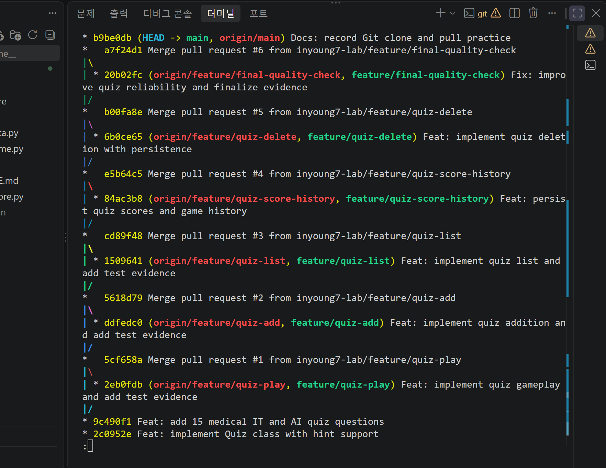

그래프 증빙은 브랜치와 커밋 관계를 보여줍니다. 저장소에 포함된 Git 실습 스크린샷은 아래에서 각각의 실습 화면을 확인하게 합니다.

- 저장소 내려받기(clone): 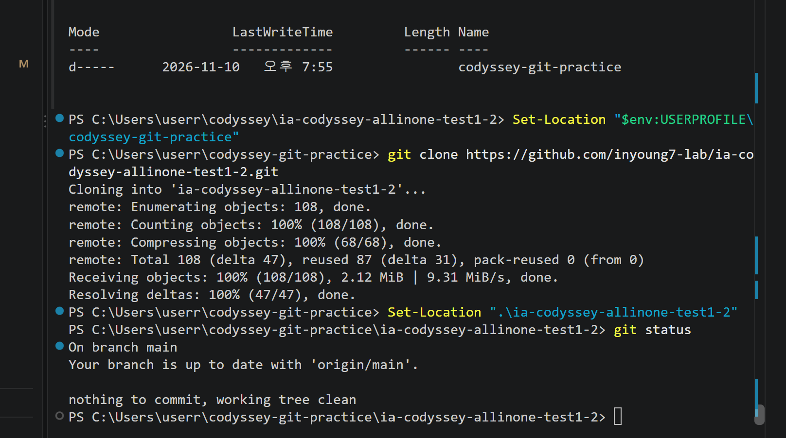
- 원격 main 최신화(pull): 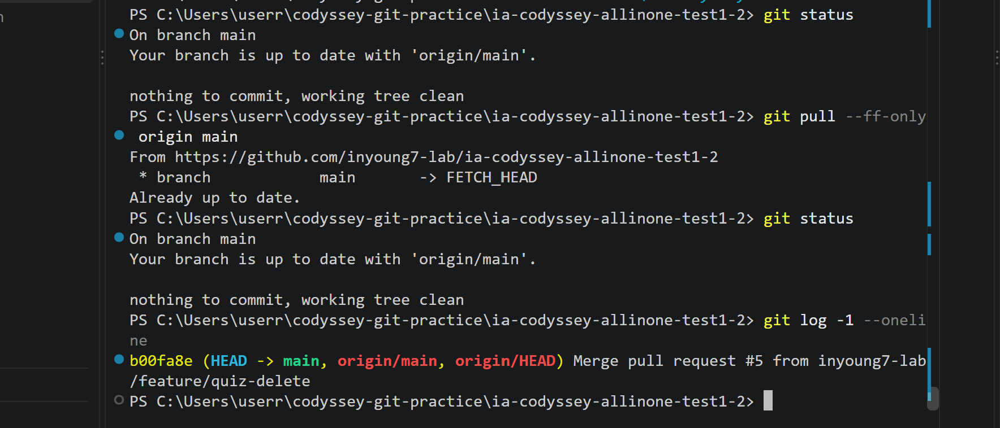
- 커밋과 원격 전송: 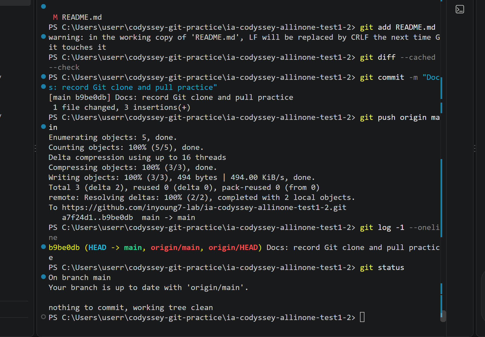
- 원본 저장소에서 pull: 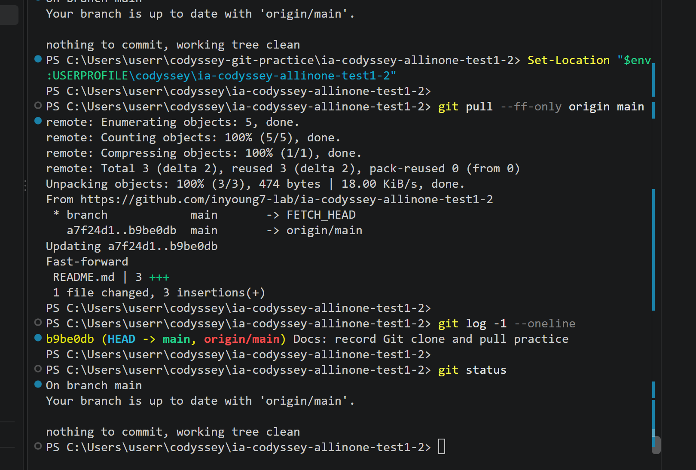
- 브랜치 전환(checkout): 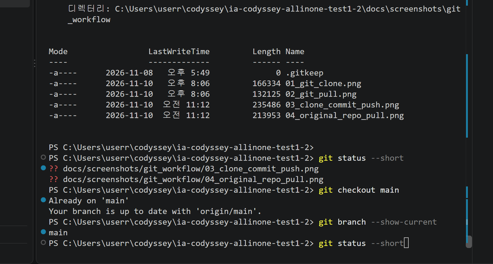
- 저장소 초기화(init): 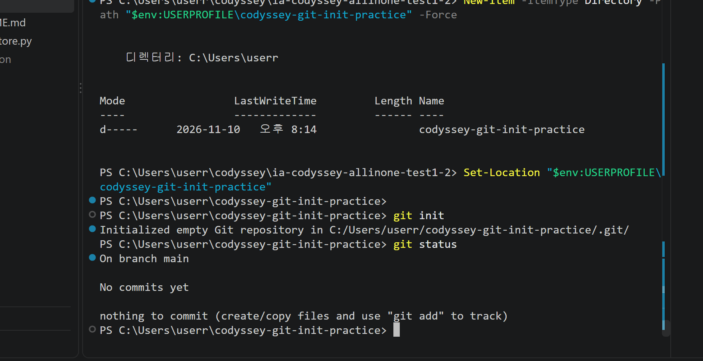

스크린샷은 명령 실행 화면의 증거입니다. 화면에 보이는 실행 주체가 현재 사용자인지까지 저장소만으로 판별할 수는 없습니다. 개별 기능 코드의 작업 커밋은 Git 이력에서 확인되지만, 커밋 작성자의 실제 역할과 각 작업에서 사람이 직접 입력한 범위는 이력만으로 확인하지 않았습니다.

## 실행 환경, 자료 출처, 검증 범위

- **실행 환경:** 이번 검토에서 실행한 인터프리터는 Python 3.12.10입니다. 구현은 Python 3.10 이상 문법을 사용합니다.
- **외부 패키지:** `requirements.txt`나 외부 라이브러리 의존성 없이 Python 표준 라이브러리를 사용합니다.
- **문제 자료:** 기본 문제 15개는 `quiz_data.py`의 상수 데이터로 저장됩니다. 프로젝트 코드에 외부 데이터/API 호출은 없습니다. 각 문항의 외부 출처·사실 검수 기록은 저장소에서 확인되지 않습니다.
- **저장 형식:** `state.json`의 스키마는 버전, 퀴즈, 최고 점수, 히스토리입니다. 개인 실행 기록이므로 `.gitignore`에서 Git 추적을 제외합니다. 이 문서에는 실제 사용자 상태 파일의 값을 옮기지 않았습니다.
- **검증 범위:** 코드 단위 테스트와 통합 테스트가 입력, 경계값, 기록, 파일 복원, 오류 처리 등을 확인합니다. Git 커밋 그래프와 PNG 증빙도 저장소에서 확인했습니다.
- **미확인:** 이번 요청에는 과제 원문·평가 기준 대신 자리표시자만 들어 있어 정확한 공식 요구 문구, 배점, 보너스 분류는 대조하지 못했습니다. 외부 문제 출처와 실제 스크린샷 촬영자의 신원도 저장소에서 확인되지 않습니다.
- **수동 화면 실행:** 저장된 PNG 증빙은 존재하지만, 이번 문서 작업 중 브라우저나 콘솔을 새로 조작해 화면 동작을 재검증하지 않았습니다. 자동 테스트 결과와 기존 이미지가 확인 근거입니다.

## AI 도구와 학습자 역할

대화 기록과 저장소 이력에서 확인되는 범위에서, AI 보조 도구는 기능 구현을 위한 코드 초안·수정과 테스트 작성 및 실행을 지원했습니다. 학습자는 구현할 메뉴와 동작, 입력 검증, 저장·삭제 조건, 변경 금지 범위와 완료 검증 항목을 구체적으로 제시하고 결과를 요청했습니다. 이번 단계에서는 AI 보조 도구가 이 안내서 초안을 작성했고, 코드·테스트·증빙을 근거로 내용을 정리했습니다.

기존 이미지와 커밋은 프로젝트 진행의 기록이지만, 학습자가 각 코드를 직접 작성했는지, 어떤 명령을 직접 입력했는지, 이미지 촬영을 직접 했는지까지 증명하지는 않습니다. 그런 역할 구분은 대화와 저장소 자료만으로 확정할 수 없어 확인되지 않은 개인 수행을 사실처럼 쓰지 않았습니다.

## 파일 안내

| 경로 | 역할 |
|---|---|
| `main.py` | 메뉴 출력, 입력 검증, 추가·목록·삭제와 실행 흐름 |
| `quiz.py` | 문제 하나의 자료와 정답 판정 |
| `quiz_data.py` | 의료 IT·인공지능·디지털 헬스케어 기본 15문항 |
| `quiz_game.py` | 문제 수 선택, 무작위 출제, 힌트와 점수 계산 |
| `state_store.py` | JSON 상태의 불러오기·저장·오류 복구 |
| `state.json` | 개인 퀴즈와 점수 상태, Git 제외 대상 |
| `tests/` | Python `unittest` 자동 검사 |
| `docs/screenshots/` | 기능·오류 처리·환경·Git 실습 증빙 이미지 |
